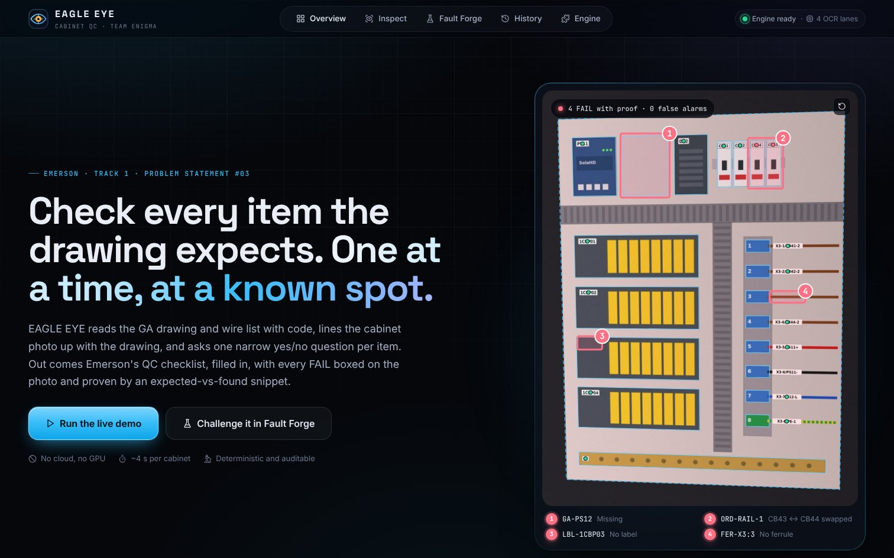
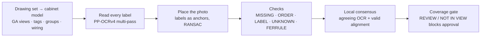
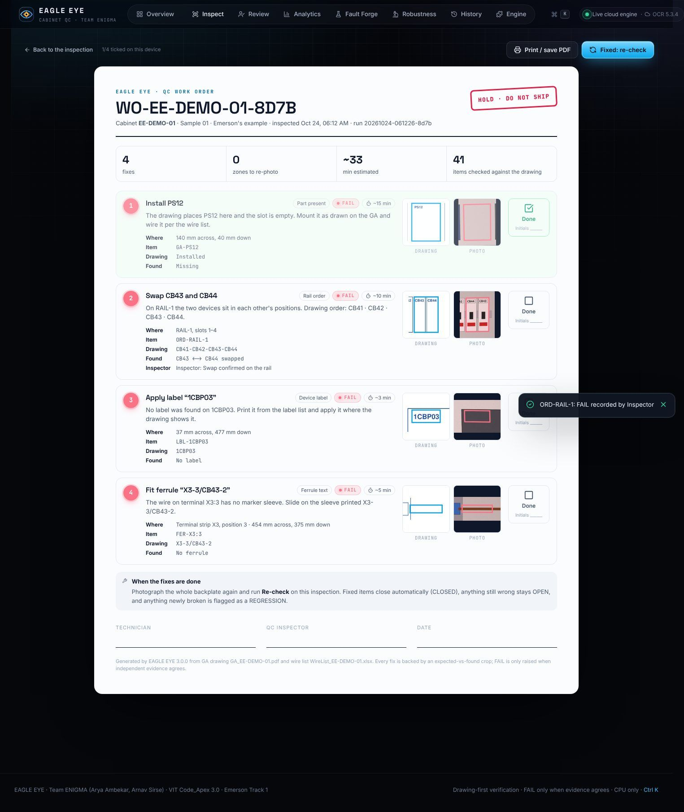
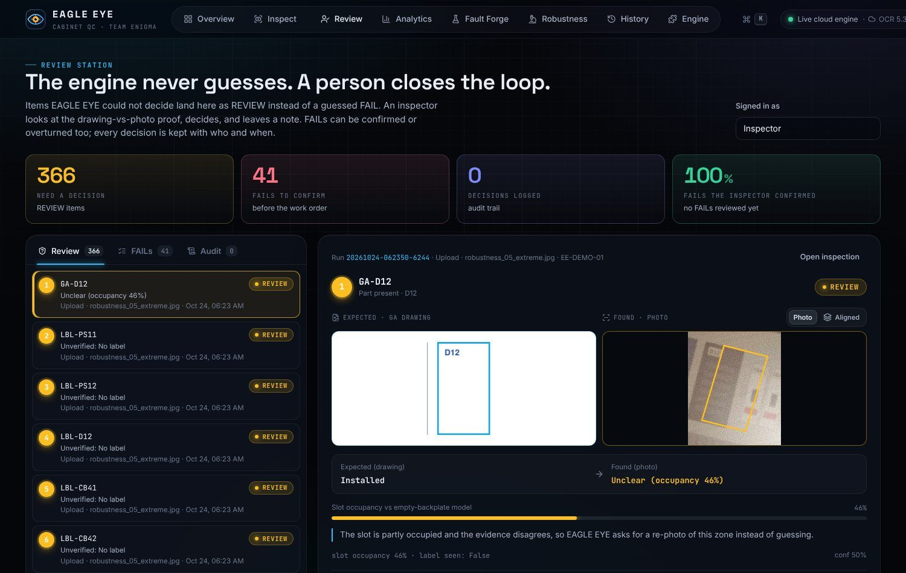
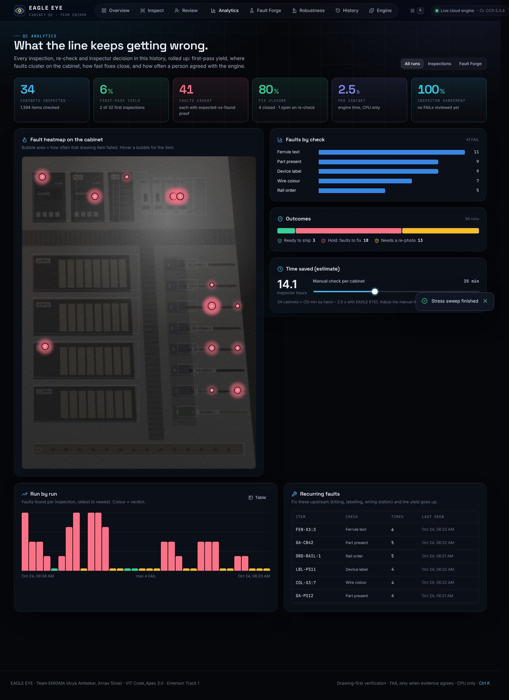
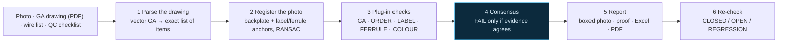
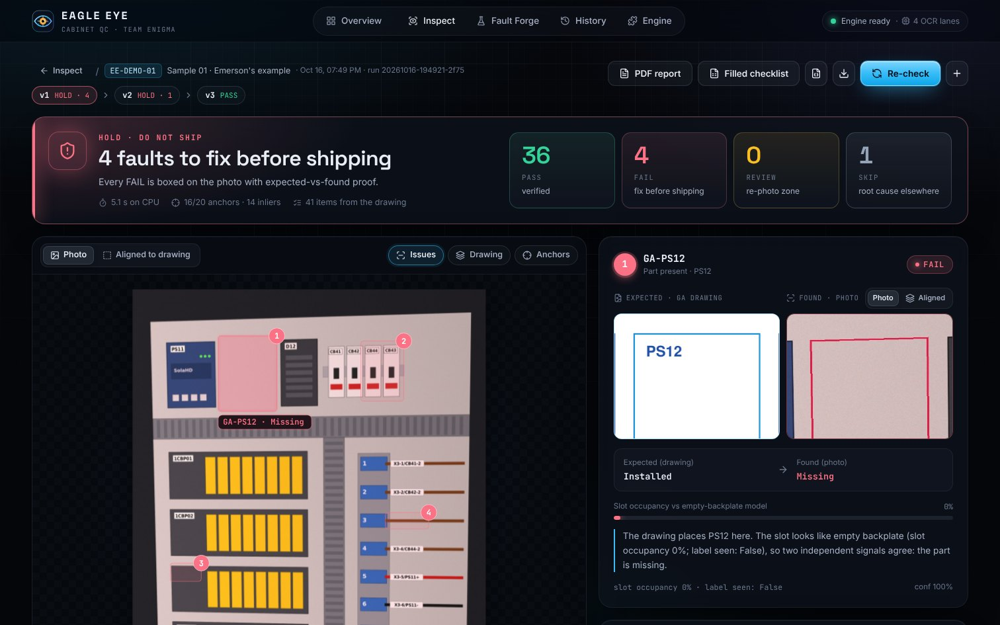
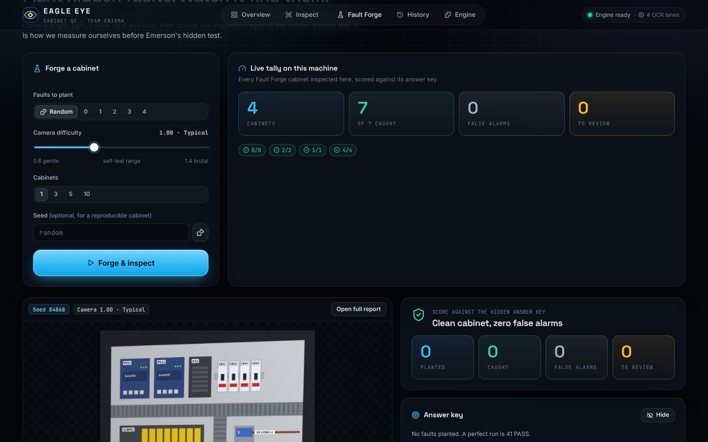
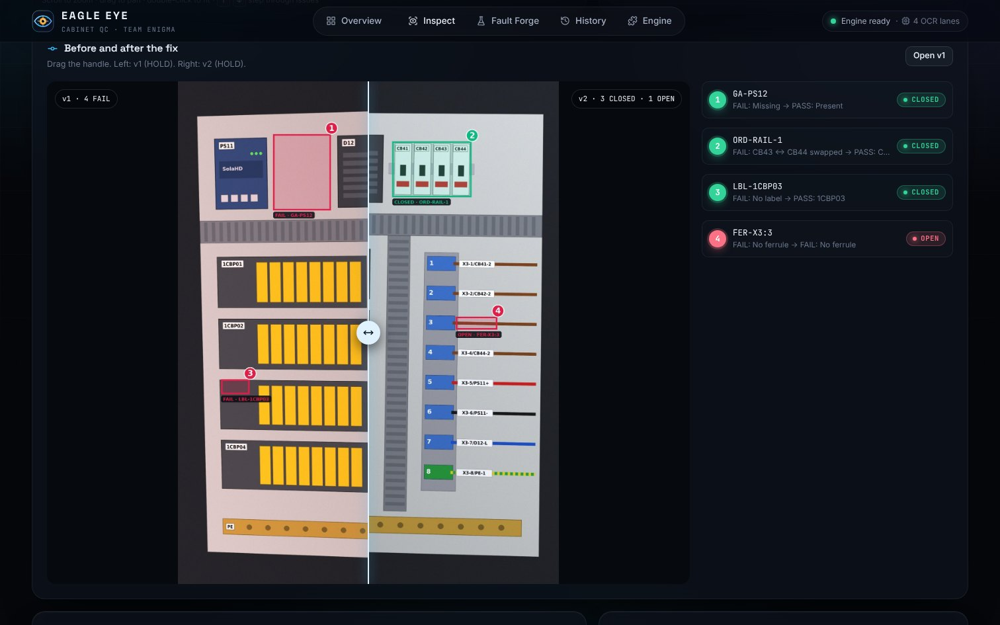

# EAGLE EYE

**Drawing-first QC for control cabinets.** A cabinet photo, its GA drawing and its wire list go in. Out comes Emerson's QC checklist, filled in, with every FAIL boxed on the photo and backed by an expected-vs-found snippet.

Team ENIGMA (Arya Ambekar, Arnav Sirse) · VIT Code_Apex 3.0 · Emerson Track 1, Problem Statement #03

**▶ Live console: https://aegis-eagle-eye.vercel.app** · engine API: https://aegis-engine-beta.vercel.app/api/v2/health · the full console on the real engine in the cloud: upload a photo or a drawing set, inspect, prove, print the work order, re-check, review, analyse. Nothing to install: Vercel builds the engine image (Python, PP-OCRv4, OpenCV, PyMuPDF) and the console from this repository on every push. If the engine is unreachable the console falls back to instant replays recorded from the same engine.



> We don't ask AI "what's wrong in this photo?". We check every item the drawing expects, one at a time, at a known spot.

**Inspection safety update (3.1).** Real uploads require their matching GA drawing or real preset. The demo drawing is
only used in explicit synthetic mode. Failed alignment blocks spatial judgments; unreadable labels remain REVIEW,
and unseen components remain NOT IN VIEW. Partial coverage cannot approve a cabinet. All AI inference runs locally;
external AI API calls are disabled in code. See the [setup and validation guide](docs/DEPLOY.md).

| Self-test on 50 unseen cabinets | |
|---|---|
| Planted faults caught | **87 / 87** |
| False alarms (correct items marked FAIL) | **0** of 1,950 |
| Correct items sent to REVIEW instead of guessing | 18 / 1,950 (0.92%) |
| Time per cabinet | **0.89 s** mean in this local CPU run; hosted latency must be measured separately |
| Degraded photos (tilt, blur, glare, noise, colour cast) | **0** false FAILs on 115 photos; unclear zones go to REVIEW |

The 3.1 run above uses Fault Forge's generated cabinets (held-out seeds 200–249), not real cabinet validation.
The degraded-photo figure is from the earlier stress sweep. The current version's measured results are exposed in **Fault Forge → Real vs synthetic**; unmeasured
values stay blank. Confirmed defects and referrals to REVIEW are counted separately. See [honest limits](#honest-limits).

## Grand finale: Emerson's real cabinet (13GE03331)

The finale engine reads Emerson's real drawing set (17-page vector PDF) and phone photos of the built cabinet. Nothing
is hard-coded for this cabinet: views, tags, device groups, label sizes and wiring come from the PDF.



| Historical evaluation on 5 real photos (previous engine; not revalidated for 3.1) | |
|---|---|
| Visible labels verified (hand-made ground truth) | **53 / 58** |
| False FAIL | **0** |
| Real drawing-vs-cabinet differences referred or confirmed | 16 / 23 (historical metric combined REVIEW and FAIL; this is not confirmed defect recall) |
| Planted faults in real photos (label removed / reprinted / swapped) | **5 / 7** referred or confirmed; historical metric combined REVIEW and FAIL |
| Unclear items | REVIEW with a re-photo hint (12 % of judged items, mostly labels hidden by cables) |

* **Only what is visible is judged.** Items outside the photo, too small to read, or beyond the labels the photo could
  anchor are NOT IN VIEW: neither passed nor failed.
* **FAIL needs agreeing evidence, no API key and no model training.** A wrong or unknown label read identically by two
  repeated OCR passes with valid drawing geometry, or two labels read at each other's drawn spots, can FAIL. Absence never does: a label
  hidden by a cable looks like a missing part, so it is REVIEW with a re-photo hint. External model credentials do not
  enable hosted inference in this version.
* **Photos are kept as metadata, not photos.** The browser sends the photo's SHA-256 fingerprint first; the engine reads
  a photo once and keeps only its fingerprint, size, quality, OCR reads, results, a small preview and proof crops.
  Responses are JSON; the browser draws the boxes on its own copy. The same photo again is answered without an upload.
* Reproduce: put the drawing set and photos in `data/emerson/` (git-ignored), then `python eval_real.py` and
  `python forge_real.py && python eval_real.py --forged` in `eagle_eye/`. Locally the console shows an
  "Emerson 13GE03331" preset on the Inspect page.

## Round 3: the complete prototype

| | |
|---|---|
| **Live cloud engine** | The same Python engine in a stateless container (`/api/v2`, NDJSON streaming). Any photo, any drawing set, any check selection, from any browser or phone. |
| **5× faster engine** | OCR runs in-process through libtesseract's C API: identical text on 1,668 test crops, identical self-test, 4 s → 0.9 s per cabinet. |
| **Technician work order** | Every FAIL as a numbered fix with location, proof crops, time estimate and sign-off. Print or save as PDF. |
| **Review station** | Human in the loop: confirm or overturn findings with the proof on screen; every decision audit-logged (who, what, when). |
| **QC analytics** | First-pass yield, fix closure, inspector agreement, time saved, and a heatmap of where faults cluster on the cabinet. |
| **Robustness Lab** | Degrade a synthetic photo (tilt, keystone, blur, glare, noise, colour cast, JPEG) and inspect it. The recorded sweep had no false FAILs; uncertainty increases REVIEW and does not establish real-photo accuracy (see the [engine README](eagle_eye/README.md#precision-under-bad-photos)). |
| **Capture assistant** | Camera capture with a framing guide and an instant photo score (sharpness, exposure, glare) before a run is spent on a bad photo. |
| **Presenter mode + Ctrl K** | The demo script on screen with clicker support, and a command palette to jump anywhere. |

| Work order | Review station | Analytics |
|---|---|---|
|  |  |  |

Presenting? Read the [Round 3 run-sheet](docs/ROUND3_RUNSHEET.md).

---

## Run it

You need **Python 3.11–3.12 (3.12 recommended)** and **Tesseract OCR**. The pinned RapidOCR package does not support Python 3.13.

| | Install Tesseract | Start EAGLE EYE |
|---|---|---|
| **Windows** | [UB-Mannheim installer](https://github.com/UB-Mannheim/tesseract/wiki) (default path is found automatically) | double-click `eagle_eye\run.bat` |
| **macOS** | `brew install tesseract` | `./eagle_eye/run.sh` |
| **Linux** | `sudo apt install tesseract-ocr` | `./eagle_eye/run.sh` |
| **Docker** | included | `docker build -t eagle-eye . && docker run -p 8000:8000 eagle-eye` |

The launcher creates a virtual environment, installs the requirements on first run and opens **http://127.0.0.1:8000**. Manual route:

```bash
cd eagle_eye
pip install -r requirements.txt
pip install --no-deps rapidocr-onnxruntime==1.4.4
python server.py              # web console (recommended)
streamlit run app.py          # lightweight Streamlit UI, same engine
python demo.py                # command-line demo: inspect -> fix -> re-photo -> re-check
```

No Node.js is needed: the built web console ships in `eagle_eye/web/dist`.

**Hosted version.** Two Vercel projects from this repo: the console (`eagle_eye/web`, `npm run build:static`, engine URL in `.env.static`) and the engine container (`eagle_eye/Dockerfile.vercel`). `python export_static.py` records the replay runs the console falls back to. Details: [engine README](eagle_eye/README.md#hosted-console-and-cloud-engine).

## What to click

| Try | Do this | You should see |
|---|---|---|
| Live demo | **Overview → Run the live demo** | 4 FAIL, 1 SKIP, 36 PASS in a few seconds: PS12 missing, CB43 ↔ CB44 swapped, 1CBP03 no label, X3:3 no ferrule |
| Proof | Click any issue | Drawing crop next to the photo crop, the evidence, and why the engine decided |
| Registration | Toggle **Drawing** and **Anchors** on the photo | The GA drawing laid onto the photo; the swapped breakers' labels light up as off-pattern anchors |
| Re-check | Scroll to **Re-check**, pick sample **05** | 3 CLOSED, 1 OPEN, with a before/after slider |
| Clean cabinet | **Inspect → sample 02** | 41 / 41 PASS, no false alarms |
| Unseen cabinet | **Fault Forge → Forge & inspect** | A new cabinet with hidden faults; reveal the answer key and compare |
| Reports | **PDF report** / **Filled checklist** buttons | One-click PDF QC report and Emerson's Excel checklist filled in |
| Work order | **Work order** on any inspection | Printable fix list: 4 numbered fixes, ~33 min, with proof crops |
| Human review | **Review**, press **F** or **P** | The decision lands in the audit trail and in Analytics |
| Bad photos | **Robustness → Stress sweep** | 5 runs from clean to extreme; false alarms stay at 0 |
| Anywhere | `Ctrl K` | Command palette; *Start presenter mode* |

## How it works



1. **Read the drawing with code, not AI.** The GA PDF is vector, so PyMuPDF pulls every tag and box exactly.
2. **Labels are the registration anchors.** Backplate outline first, then every label and ferrule read with certainty becomes an anchor for a RANSAC homography. Anchors that don't fit point to misplaced parts.
3. **Swap-aware order check.** Labels are read slot by slot along the rail and aligned with the drawing's sequence, so the tool says "CB43 ↔ CB44 swapped".
4. **Wire-list-constrained OCR.** Ferrule text is decoded against the wire list (a closed vocabulary) with OCR-confusion handling, never read freely.
5. **Precision-first consensus.** FAIL only when independent evidence agrees. Unclear items go to REVIEW ("re-photo this zone"). A photo that doesn't register against the drawing can't produce a FAIL at all.
6. **Root-cause de-duplication and Fault Forge.** A missing part is one FAIL, not five. Fault Forge plants faults in generated cabinets so we measure ourselves before Emerson's hidden test.

| Result | Fault Forge | Re-check |
|---|---|---|
|  |  |  |

## Repository

```
eagle_eye/
  kb/              real drawing sets -> cabinet model (views, tags, groups, wiring), cached by SHA-256
  vision/          photo loading, PP-OCRv4 multi-pass reader, closed-vocabulary decoding, registration
  checks/          real-cabinet plug-in checks (MISSING, ORDER, LABEL, UNKNOWN_LABEL, FERRULE, COLOUR)
  agent/           offline verification fixtures and replay tooling; hosted inference disabled
  consensus.py     candidates + verifier -> PASS / FAIL / REVIEW / NOT_IN_VIEW, multi-photo merge
  pipeline.py      real-cabinet pipeline; forge_real.py / eval_real.py measure it on real photos
  inspector.py     demo-cabinet engine: drawing parser, registration, plug-in checks, consensus
  service.py       run store, re-check chains, proof crops, Fault Forge scoring
  server.py        FastAPI backend + web console (python server.py), stateless cloud API /api/v2
  ocr_capi.py      in-process libtesseract (C API), 5x faster OCR with identical text
  Dockerfile.vercel  engine container Vercel builds for the hosted console (Dockerfile.engine: Cloud Run / Render / on-prem)
  report.py        marked photo, crops, GA overlay, filled Excel checklist, re-check
  pdf_report.py    one-click PDF QC report
  render.py        photo generator + Fault Forge
  spec.py          builds the demo inputs (GA PDF, wire list, QC checklist)
  app.py           Streamlit UI (fallback, Streamlit Cloud)
  demo.py · eval_forge.py · make_samples.py
  inputs/          demo GA drawing, wire list, QC checklist
  sample_photos/   5 test photos + ANSWER_KEY.txt
  web/             React + TypeScript console (source and built dist/)
  tests/           pytest: engine, service, API
docs/              screenshots, run-sheets, FINALE_ENGINE_SPEC.md, DEPLOY.md
```

Engine details, the API and how to add a check: [`eagle_eye/README.md`](eagle_eye/README.md).

## Honest limits

- Real-cabinet numbers come from 5 photos of one cabinet and its hand-made answer key: a small sample.
- A missing part is never FAIL on its own (REVIEW instead): absence cannot be told
  apart from a label hidden by cables in a photo.
- Reading a full-resolution real photo takes 1-2 minutes on one CPU (the hosted engine has one vCPU); results are cached
  by photo fingerprint, so the same photo again is instant.
- Labels hidden by cables, or labels whose neighbours could not be read, are REVIEW or NOT IN VIEW, never FAIL.
- Very bad photos lose findings to REVIEW (the stress sweep catches 4/4 on mild, 3/4 on moderate, 0/4 once the photo no longer registers): safe, but a re-photo is needed.
- The tool needs a vector GA PDF in this format. Scanned drawings are a later step.

## Tools declared

Python, OpenCV, PyMuPDF, PP-OCRv4 (RapidOCR on ONNX Runtime), Tesseract OCR, NumPy, openpyxl, ReportLab, FastAPI,
React, pdf-lib, Streamlit, Vercel. An AI coding assistant helped write the code,
as the rules ask us to declare.
